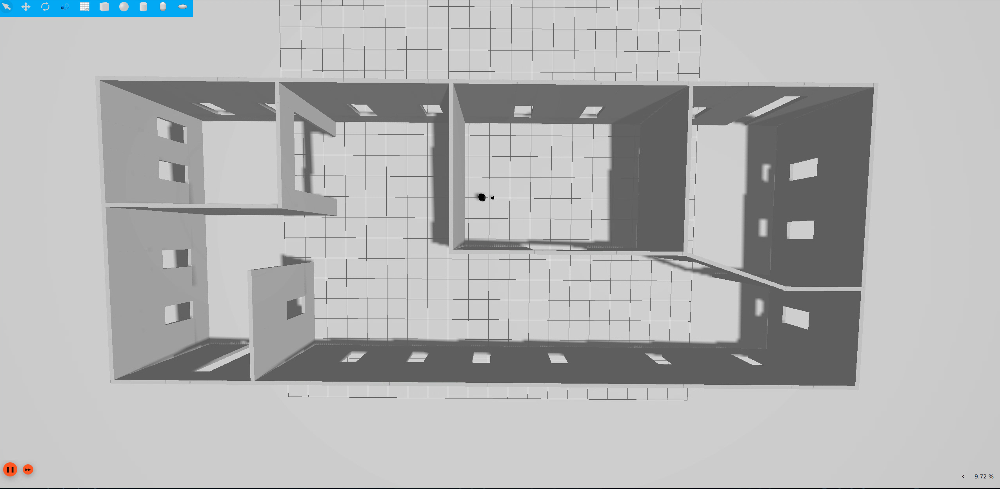

# ICTE4001 Case Study 2: GMapping SLAM on TurtleBot4 (ROS 2 Humble)

Reproduction package for our ICTE4001 Case Study 2 report (Curtin University). We study **GMapping**, a Rao-Blackwellised particle filter SLAM algorithm, run it on a simulated TurtleBot4, and connect it to **Nav2** for autonomous navigation. Nav2 is localised by GMapping itself (no AMCL) while the map is being built.


## 1. Environment

| Item | Version / setting |
| --- | --- |
| OS | Ubuntu 22.04 |
| ROS 2 | Humble |
| Simulator | Gazebo (Ignition) Fortress, `office_world` from the unit's `turtlebot_virtual_lab` package |
| Robot | Simulated TurtleBot4 (standard model) |
| SLAM | GMapping: OpenSLAM core + ROS 2 port by Project-MANAS, patched by us (see `docs/`) |
| Navigation | Nav2 (`nav2_bringup`), NavFn planner, DWB controller |
| Machine used for the runs | Curtin VDI remote desktop ("PLC - ROS2 Humble"), no GPU |



Install the ROS packages (same list as the unit's setup guide):

```bash
sudo apt install ros-humble-desktop ros-humble-navigation2 ros-humble-nav2-bringup \
  ros-humble-turtlebot4-description ros-humble-turtlebot4-msgs ros-humble-turtlebot4-navigation \
  ros-humble-turtlebot4-node ros-humble-turtlebot4-desktop ros-humble-turtlebot4-simulator \
  ros-humble-irobot-create-nodes ros-humble-teleop-twist-keyboard python3-colcon-common-extensions
```

## 2. Build

```bash
# 1. the unit's simulator workspace with the office world
cd ~/turtlebot_virtual_lab && source /opt/ros/humble/setup.bash && colcon build
source ~/turtlebot_virtual_lab/install/setup.bash

# 2. this repository
git clone https://github.com/mfathiibrahim77/ICTE4001-GMapping-TB4.git ~/ICTE4001-GMapping-TB4
cd ~/ICTE4001-GMapping-TB4 && colcon build
source install/setup.bash
```

## 3. Simulator speed-up (slow PC / VDI only)

With the default sensor rates the VDI ran the simulation at under 10% real time, and Nav2 rejected every plan because the transforms arrived too late. `scripts/fast_sim_overlay.sh` copies the two robot description packages into `~/tb4_fast_overlay` (no sudo, `/opt` is not touched) and lowers the rates of sensors that GMapping and Nav2 do not use, plus the lidar:

| Sensor | Default | Ours | Used by SLAM/Nav2? |
| --- | --- | --- | --- |
| RPLIDAR (`rplidar.urdf.xacro`) | 62 Hz | 10 Hz (the real RPLIDAR A1 runs at 5.5–10 Hz) | Yes |
| OAK-D camera (`oakd.urdf.xacro`) | 30 Hz | 1 Hz | No |
| Cliff sensors ×4 (`cliff_sensor.urdf.xacro`) | 62 Hz | 5 Hz | No |
| IR intensity ×7 (`ir_intensity.urdf.xacro`) | 62 Hz | 5 Hz | No |

IMU, wheel and bumper sensors are not changed. The real-time factor went from mostly below 10% to about 50%.

```bash
bash scripts/fast_sim_overlay.sh                 # once; prints the new rates
source ~/tb4_fast_overlay/setup.bash             # in the simulator terminal only
```
Undo: `rm -rf ~/tb4_fast_overlay` and open a new terminal.

## 4. Launch sequence

Each command in its own terminal, in this order.

```bash
# simulator (add the overlay line above on a slow machine), then undock
export IGN_IP=127.0.0.1; export IGN_PARTITION=$USER     # shared VDI: keep Gazebo private
ros2 launch turtlebot4_ignition_bringup turtlebot4_ignition.launch.py world:=office_world
ros2 action send_goal /undock irobot_create_msgs/action/Undock {}

# GMapping + RViz
ros2 launch tb4_gmapping_nav gmapping.launch.py rviz:=true

# drive: teleop ...
ros2 run teleop_twist_keyboard teleop_twist_keyboard
# ... or Nav2 on the live map (GMapping provides map -> odom, no AMCL)
ros2 launch nav2_bringup navigation_launch.py use_sim_time:=true \
  params_file:=$(ros2 pkg prefix tb4_gmapping_nav)/share/tb4_gmapping_nav/config/nav2_params.yaml

# save the map
ros2 run nav2_map_server map_saver_cli -f ~/gmapping_map --ros-args -p save_map_timeout:=20.0
```

With Nav2 running, use **2D Goal Pose** in RViz. Goals into unexplored (grey) space are allowed. 2D Pose Estimate is not needed because nothing listens to it without AMCL.

**Navigation on a saved map** (Nav2 `map_server` + AMCL, as in Practical 7). Stop GMapping first, then use **2D Pose Estimate** before **2D Goal Pose**:

```bash
ros2 launch nav2_bringup localization_launch.py map:=$(pwd)/results/maps/e1_teleop_map.yaml \
  params_file:=$(pwd)/config/amcl_sim.yaml use_sim_time:=true
ros2 launch turtlebot4_viz view_robot.launch.py use_sim_time:=true
ros2 launch nav2_bringup navigation_launch.py use_sim_time:=true \
  params_file:=$(ros2 pkg prefix tb4_gmapping_nav)/share/tb4_gmapping_nav/config/nav2_params.yaml
```

**Map accuracy** against the reference map of the same world (any machine with Python):

```bash
python3 src/tb4_gmapping_nav/scripts/map_compare.py --ref results/maps/office_ICTE4001_sim.yaml \
  --maps results/maps/e1_teleop_map.yaml results/maps/e4_nav2_map.yaml --out results/map_eval
```

## 5. Repository contents

| Path | What it is | Changed from upstream? |
| --- | --- | --- |
| `src/slam_gmapping/openslam_gmapping/` | GMapping algorithm core (OpenSLAM) | One getter added (`getWeights()`) |
| `src/slam_gmapping/slam_gmapping/` | ROS 2 GMapping node | Yes: parameters from YAML, latched `/map`, map-update timer fix, range handling, timestamp fix, entropy/N_eff, particle cloud, Humble build fixes. All marked `[ICTE4001]` |
| `src/tb4_gmapping_nav/launch/` | `gmapping.launch.py` (SLAM + RViz), `slam_nav.launch.py` (SLAM + Nav2) | Ours |
| `src/tb4_gmapping_nav/config/gmapping.yaml` | GMapping parameters tuned for the TurtleBot4 | Ours |
| `src/tb4_gmapping_nav/config/nav2_params.yaml` | Nav2 parameters (based on Practical 7) | Planner set to NavFn |
| `src/tb4_gmapping_nav/config/nav2_params_iar_astar.yaml` | Same, using our Practical 7 A* planner | Ours |
| `src/tb4_gmapping_nav/scripts/` | `slam_eval_recorder.py`, `drive_waypoints.py`, `analyse_run.py`, `map_compare.py` (evaluation tools) | Ours |
| `src/tb4_cpp_prac7/` | Our Practical 7 A* global planner (Nav2 plugin) | Ours |
| `scripts/fast_sim_overlay.sh` | Lower simulated sensor rates (section 3) | Ours |
| `config/amcl_sim.yaml` | AMCL settings for the simulator (`base_link` instead of `base_footprint`) | Ours |
| `docs/CODE_MAP.md` | Call graph and theory-to-code table | Ours |
| `docs/ICTE4001_gmapping_changes.patch` | Full diff of our changes to the upstream port | Ours |
| `results/maps/` | Saved GMapping maps (`e1_teleop_map`, `e4_nav2_map`) and the reference map `office_ICTE4001_sim` | Ours |
| `results/map_eval/` | Maps aligned on the reference (green = wall within 0.10 m) | Ours |
| `results/e4_nav_goals/`, `results/screenshots/` | Frames and screenshots from the runs | Ours |

## 6. Experiments and results

| Exp. | What | Result |
| --- | --- | --- |
| E1 | Mapping with teleop: start room, corridor, second room, back to start (loop) | Clean map, straight single walls, loop closed with no doubled walls. 100% of map walls within 0.10 m of the reference, recall 94.9% |
| E2 | Live GMapping + Nav2, default sensor rates (RTF < 10%) | Nav2 planned correct paths, but goals failed: `map -> odom` arrived 20–140 s late |
| E3 | Saved E1 map + AMCL + Nav2, default sensor rates | AMCL localised; Nav2 planned around a wall and through a doorway; goals failed for the same reason |
| E4 | Live GMapping + Nav2 after the sensor speed-up (RTF ≈ 50%), map built by Nav2 goals only | 5/5 goals reached; map 100% precision, recall 96.1%. GMapping stopped updating after ~1670 scan updates (see below) |

**Map accuracy** (`map_compare.py`, rigid alignment on the reference map, tolerance 0.10 m):

| Map | Known area | Coverage of office | Mean wall distance | Wall within 0.10 m (precision) | Reference walls found (recall) |
| --- | --- | --- | --- | --- | --- |
| E1 teleop | 265 m² | 64% | 0.016 m | 100% | 94.9% |
| E4 Nav2 goals | 193 m² | 62% | 0.016 m | 100% | 96.1% |

The reference map (`office_ICTE4001_sim`, from Practical 6) was itself made by SLAM, so it is a reference rather than exact ground truth. A mean wall distance of 0.016 m is a third of one 0.05 m cell. The E4 map is rotated 10.8° relative to the world because GMapping starts the map frame at the robot's start pose.

**E4 goals** (from the screen recording, video is 3–4× speed):

| Goal | Target | Result |
| --- | --- | --- |
| G1 | Start room → doorway | Reached |
| G2 | Through the doorway, east along the corridor | Reached |
| G3 | Corridor outside the second room | Reached |
| G4 | East end of the corridor | Reached |
| G5 | West end of the corridor (~15 m) | Reached |
| G6 | West room (unexplored) | Robot drove there, but GMapping had stopped updating, so the room was not added to the map |

During E1 the GMapping log showed an average scan-matching score of about 610 and N_eff of about 49.8 of 50 particles (no resampling needed on this route).

**Why GMapping stopped in E4.** Each map update re-draws every stored scan of the best particle's trajectory (`updateMap()`), so its cost grows with the length of the run. With `map_update_interval: 1.0` and RViz using ~140% CPU, the redraw fell behind after ~1670 scan updates and scans were dropped. `gmapping.yaml` now uses 5.0 s (the ROS default).

| Figure | |
| --- | --- |
| `results/map_eval/e1_teleop_map_vs_reference.png` | E1 map aligned on the reference |
| `results/map_eval/e4_nav2_map_vs_reference.png` | E4 map aligned on the reference |
| `results/e4_nav_goals/g1_start_room.png` … `g4_corridor_east.png` | E4: Nav2 paths on the live GMapping map |
| `results/e4_nav_goals/g6_map_stalled.png` | E4: laser sees the west room, map no longer updated |
| `results/screenshots/fig1_final_map.png` | E1 final map |
| `results/screenshots/fig2_back_at_start.png` | E1: back at the start, laser aligned with the first-mapped walls (loop closure) |
| `results/screenshots/fig3_nav2_live.png` | E2: Nav2 path on the live map |
| `results/screenshots/fig4_nav2_saved_map_doorway.png` | E3: AMCL particles, costmap and path through the doorway |

Videos: *links to be added* (E1 mapping, E4 Nav2 goals)

## 7. Troubleshooting

| Symptom | Cause | Fix |
| --- | --- | --- |
| Gazebo real-time factor < 20%, Nav2 `Transform data too old`, `Goal failed` | Sensor rendering on a CPU-only machine | Section 3; minimise (don't close) the Gazebo window |
| Gazebo stuck on `Requesting list of world names` | `turtlebot_virtual_lab` not built (only `src/` present), old Gazebo processes, or other VDI users on the same Gazebo partition | Build and source the workspace; `pkill -9 -f ruby; pkill -9 -f "ign gazebo"`; `export IGN_IP=127.0.0.1 IGN_PARTITION=$USER` |
| Nav2: `Could not find a connection between 'odom' and 'base_link'` | Simulator closed or still starting (closing the Gazebo window stops the simulation) | Check `ros2 run tf2_ros tf2_echo odom base_link`; restart the simulator, then GMapping and Nav2 |
| GMapping stops printing `update frame`, new rooms stay grey | Map redraw too slow (see section 6), CPU starved by RViz | `map_update_interval: 5.0`; untick particles and costmaps in RViz; save the map before restarting GMapping |
| Robot jumps constantly in RViz | Two GMapping nodes running | `ros2 node list`; run only one `/slam_gmapping` |
| Robot will not move after a bump; `motion_control` warns about `back up limit` or `Reflex` | Create 3 safety reflexes | Turn away / drive forward, or restart the simulator |
| Map is rotated relative to the Gazebo grid | Map frame = robot start pose | Normal |
| `map_saver`: `Failed to spin map subscription` | Default 2 s wait too short | `--ros-args -p save_map_timeout:=20.0` |
| AMCL: `base_footprint does not exist` | Nav2 default frame name | Use `config/amcl_sim.yaml` (`base_link`) |
| Nav2 output ends with `Creating bond timer` | Normal last start-up line | Look for `Managed nodes are active` above it |
| `turtlebot4_node`: `Service oakd/start_camera unavailable` | No camera service in simulation | Ignore |

## 8. Known limitations

- Simulation only, one run per experiment.
- No ground-truth trajectory was recorded, so localisation accuracy is judged from map accuracy against the reference map and from loop closure, not from trajectory error.
- The reference map was made by SLAM in Practical 6, not taken from the world file.
- GMapping cannot load a saved map and continue; every run starts a new map. Navigation on a saved map needs AMCL.
- `updateMap()` cost grows with the trajectory length (section 6), so long runs need a larger `map_update_interval`.
- The sensor-rate changes alter the simulated robot; only the lidar change affects GMapping.
- About a third of the office (the west rooms) was not mapped.
- The 2D laser cannot see the charging dock (it is below the scan plane).
- GMapping has no explicit loop-closure module; it relies on good particles surviving resampling, which can fail on long loops in large environments.

## 9. Notes

- GMapping core: G. Grisetti, C. Stachniss and W. Burgard (OpenSLAM, BSD licence). ROS 2 port: Project-MANAS (https://github.com/Project-MANAS/slam_gmapping).

## Authors

ICTE4001 Group ___: _names / student IDs_
