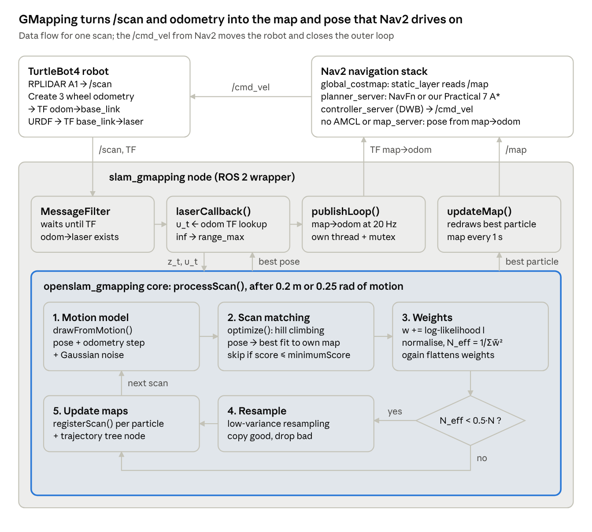

# ICTE4001 Case Study 2 - GMapping on TurtleBot4

GMapping SLAM + Nav2 on the simulated TurtleBot4 (ROS 2 Humble, Gazebo Fortress, office_world).
GMapping builds the map and gives Nav2 the robot pose, so no AMCL needed while mapping.



## setup

you need the unit's `turtlebot_virtual_lab` workspace built first (that's where office_world is).

```bash
source /opt/ros/humble/setup.bash
cd ~/turtlebot_virtual_lab && colcon build && source install/setup.bash
git clone https://github.com/mfathiibrahim77/ICTE4001-GMapping-TB4.git ~/gmapping_ws
cd ~/gmapping_ws && colcon build && source install/setup.bash
```

every new terminal:
```bash
source /opt/ros/humble/setup.bash
source ~/turtlebot_virtual_lab/install/setup.bash
source ~/gmapping_ws/install/setup.bash
```

## if the sim is slow (VDI)

run this once. it lowers the sim sensor rates (lidar 62 -> 10 Hz, camera 30 -> 1 Hz, cliff/IR 62 -> 5 Hz).
for us it went from under 10% real time to around 50%.

```bash
bash scripts/fast_sim_overlay.sh
```
then in the simulator terminal also run `source ~/tb4_fast_overlay/setup.bash` before launching.

## run (one terminal each)

```bash
# 1. sim
ros2 launch turtlebot4_ignition_bringup turtlebot4_ignition.launch.py world:=office_world

# 2. undock
ros2 action send_goal /undock irobot_create_msgs/action/Undock {}

# 3. gmapping + rviz
ros2 launch tb4_gmapping_nav gmapping.launch.py rviz:=true

# 4. nav2
ros2 launch nav2_bringup navigation_launch.py use_sim_time:=true params_file:=$(ros2 pkg prefix tb4_gmapping_nav)/share/tb4_gmapping_nav/config/nav2_params.yaml

# 5. save the map when done
ros2 run nav2_map_server map_saver_cli -f ~/gmapping_map --ros-args -p save_map_timeout:=20.0
```

then use **2D Goal Pose** in rviz. you can also drive with teleop instead of step 4:
`ros2 run teleop_twist_keyboard teleop_twist_keyboard`

## what's in here

- `src/slam_gmapping/` - gmapping (openslam core + ros2 node). our changes are marked `[ICTE4001]`
- `src/tb4_gmapping_nav/` - our launch files, configs, rviz and scripts
- `src/tb4_cpp_prac7/` - our prac 7 A* planner
- `scripts/fast_sim_overlay.sh` - the sim speed up
- `config/amcl_sim.yaml` - amcl for the sim if you want to navigate on a saved map
- `docs/` - code map and the full patch of what we changed
- `results/` - our maps, screenshots and map comparison

## results

| run | what | result |
| --- | --- | --- |
| E1 | teleop mapping, loop back to start | clean map, loop closed, no doubled walls |
| E2 | gmapping + nav2, normal sim | paths planned but goals failed (sim too slow) |
| E3 | saved map + amcl + nav2, normal sim | same, paths ok but goals failed |
| E4 | gmapping + nav2 after the speed up | 5/5 goals reached, map built only with nav2 goals |

map compared to the prac 6 office map (`results/maps/office_ICTE4001_sim`):

| map | covered | mean wall error | walls within 0.10 m | ref walls found |
| --- | --- | --- | --- | --- |
| E1 teleop | 64% | 0.016 m | 100% | 94.9% |
| E4 nav2 | 62% | 0.016 m | 100% | 96.1% |

to redo it: `python3 src/tb4_gmapping_nav/scripts/map_compare.py --ref results/maps/office_ICTE4001_sim.yaml --maps results/maps/e1_teleop_map.yaml results/maps/e4_nav2_map.yaml`

videos: _links to be added_

## what didn't work and why

**nav2 goals kept failing at first (E2, E3).**
the VDI has no GPU so gazebo was running at under 10% real time. the transforms (map -> odom) were arriving 20 to 140 s late, so nav2's controller threw the plans away ("transform data too old"). it wasn't gmapping's fault because the same thing happened with amcl. lowering the sensor rates with `fast_sim_overlay.sh` fixed it. the lidar going to 10 Hz doesn't hurt gmapping since the real RPLIDAR A1 is 5.5 to 10 Hz anyway, and the camera, cliff and IR sensors aren't used by gmapping or nav2.

**gmapping stopped updating the map halfway through E4.**
every map update redraws every scan from the whole run (`updateMap()`), so it gets slower the longer you go. with it set to update every 1 s, and rviz using a lot of cpu, it fell behind after ~1670 updates and new rooms stayed grey. we changed `map_update_interval` to 5.0 s in `config/gmapping.yaml`. also untick the particles and costmaps in rviz if it's slow.

**gazebo got stuck on "requesting list of world names".**
our `turtlebot_virtual_lab` folder only had `src` in it after unzipping again, so office_world couldn't be found. building it again (`colcon build`) fixed it.

**nav2 said it couldn't find odom -> base_link.**
we closed the gazebo window by accident, which stops the whole sim. minimise it, don't close it.

## other problems

| problem | fix |
| --- | --- |
| robot jumps around in rviz | two gmapping nodes running, check `ros2 node list` |
| robot won't move after hitting something | create3 safety reflex, drive forward or turn away |
| map is rotated compared to gazebo | normal, the map starts where the robot starts |
| map_saver fails | add `-p save_map_timeout:=20.0` |
| amcl says "base_footprint does not exist" | use `config/amcl_sim.yaml` |

## limitations

- sim only
- gmapping can't load a saved map and keep going, it always starts fresh
- west side of the office didn't get mapped
- the reference map was also made with slam so it's not perfect ground truth

## credits

gmapping by Grisetti, Stachniss and Burgard (OpenSLAM). ros2 port by Project-MANAS (https://github.com/Project-MANAS/slam_gmapping).

## group

ICTE4001 Group ___
